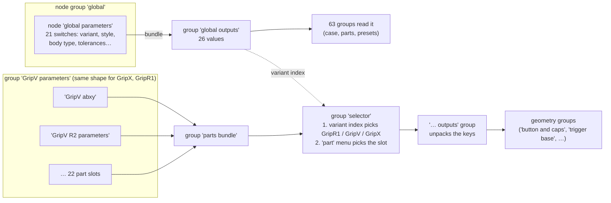

# 2. Parameter system: how a number reaches the geometry

Every printable part is generated by Geometry Nodes, and almost none of its dimensions are typed into the part's own node tree. They live in a small number of **parameter groups** and travel to the geometry inside **bundles** (Blender 5's bundle sockets). This page explains that plumbing, because it decides where you have to edit a value and why some edits do nothing.

## 2.1 The picture



Two independent channels exist [wiring]:

1. **Global switches** (one set for the whole file) in the `global parameters` node inside the `global` node group.
2. **Part presets** (one set per variant) in groups named `GripV …`, `GripX …` and `GripR1 …`.

## 2.2 Global switches

The `global` node group contains a single node, an instance of the group `global parameters`, whose 21 input values are the global switches. `global parameters` converts them (menus to indices and booleans) and packs them into a bundle; `global outputs` unpacks that bundle into 26 sockets that any group can drop in [wiring]. 97 instances of `global outputs` are placed across 63 groups [wiring].

To change a global switch you edit the input on the `global parameters` node inside `global`. The export add-on does exactly that: its overrides target `global` → `global parameters [global parameters]` → input name [wiring, from the presets]. The meaning of each switch is in [3. Global switches](03-global-switches.md).

## 2.3 Part presets

For every variant there is one **variant parameter group** (`GripV parameters`, `GripX parameters`, `GripR1 parameters`). Each one holds a node per part slot, and each of those nodes is a **preset group** such as `GripV abxy` or `GripX R2 parameters`. Inside a preset group sit instances of the generic **constructor groups** (`button parameters`, `caps parameters`, `trigger parameters`, …), and the values typed on those instances are the actual model dimensions [wiring].

```
GripV parameters
└─ GripV abxy                         (preset group, no inputs, outputs one bundle)
   ├─ button parameters   SMD height 4.4, button height 2.56, stopper position 11, …
   ├─ caps parameters     caps fit Z 2.08, cap case tolerance 0.6, cap bevel 1.6, …
   ├─ curve parameters    width 12, octagonal fillet on, fillet 1.6, …
   ├─ capacitive plate parameters   capacitive = knob, screw hole on, …
   ├─ marks parameters    text, font size, translate, …
   └─ tolerance set ×2    tight / default / loose values, picked by the global tolerance menus
```

The 22 slots of `parts bundle` are: `abxy`, `dpad`, `select`, `home`, `R2`, `R4`, `R1L1`, `R1`, `L1`, `screw`, `stick R`, `stick L`, `scrollwheel`, `pcb`, `cover`, `pin`, `dpad stick`, `indent`, `middle plate`, `hollow array`, `hollow`, `lattice` [wiring]. `GripV parameters` and `GripX parameters` leave `R1` and `L1` empty (only GripR1 fills them) [wiring].

The `indent` slot is special: each variant group holds seven indent presets (gyroid, FischerKoch S, FischerKoch CY, Voronoi, diamond, primitive, cubic) and an *Index Switch* driven by the global `fill type` picks one of them [wiring]. The menu has an eighth entry, `manual`, with no preset behind it (see [Issues](09-issues.md)).

### Where you edit a part value

Open the preset group (`GripV abxy`, `GripX stick L parameters`, …) and change the value on the constructor node inside it. The **controls panels** make this easier: `GripV controls`, `GripX contols` (sic) and `GripR1 controls` are node groups with no inputs or outputs that just hold one instance of every preset group of their variant, arranged in labelled frames (BUTTONS, STICKS, R2R4, R1L1 LEVER, SCREWS, PINS, PCB AND BATTERY, SCROLLWHEEL, DPAD STICK, pattern, shell). Because a group node shows the same group data wherever it is placed, editing inside a controls panel edits the real preset [wiring]. The group `controls` holds the three panels plus `global`, and it is attached as a modifier to the hidden reference object `case_front.002`, which gives you a way to open it in the node editor [wiring; inferred: that is the purpose of that modifier].

### How a part reads its values

A part's modifier group places a `selector` node with its `part` menu set (for example `abxy`), then one or more `… outputs` groups that unpack the bundle into named sockets [wiring]:

1. `selector` builds all three variant bundles, picks one with the global `variant index` (GripR1 = 0, GripV = 1, GripX = 2), then picks the slot named by `part`.
2. `button outputs`, `caps outputs`, `trigger outputs`, … each contain a *Separate Bundle* whose outputs go straight to the group outputs.
3. The geometry groups take those sockets as ordinary inputs.

`selector` also has a `part index` input (0 or 1) that is passed to every variant group; only the screw presets use it, to choose between the FRONT (0) and BACK (1) screw definitions [wiring].

### A worked example

`GripV abxy` → `button parameters` → **button height = 2.56**. The `abxy button` modifier's `selector` picks the `abxy` slot of the GripV bundle; `button outputs` unpacks `button height`; `button and caps` uses it. Raising it by 0.256 mm on a copy made the four abxy caps exactly 0.256 mm taller and left the button and the case unchanged [measured]. The full set of such checks is in the preset tables ([GripV](reference/preset-values-GripV.md), [GripX](reference/preset-values-GripX.md)).

## 2.4 Tolerance sets

`tolerance set` is a three-way pick: inputs `tight`, `default`, `loose` and an index `tolerance` (0, 1, 2), output one value [wiring]. Preset groups wire the index to one of the three global tolerance menus and type the three candidate values on the node, so each part decides what "tight" means for itself. All values are listed in [7. Tolerances](07-tolerances.md).

## 2.5 Bundle keys and renamed values

Constructor groups usually pack an input under its own name, but 19 of the part constructors rename some inputs on the way in, and five `… outputs` groups (`cover outputs`, `lever R1L1 outputs`, `shell outputs`, `stick outputs`, `trigger outputs`) rename keys on the way out [wiring]. Two examples that look alarming but are harmless:

- `button parameters` packs its input `case middle bevel` under the key `middle bevel` and its input `middle bevel` under `case middle bevel`. Downstream the names are crossed a second time, so the net effect matches the labels: changing `case middle bevel` changed only the case top, changing `middle bevel` changed only the button [measured].
- `stick top parameters` packs `top curvature` as `texture type` and `texture type` as `flat texture type`; `stick outputs` renames both back [wiring].

The complete list of keys per constructor, with every renamed key in bold, is in [reference/parameter-groups.md](reference/parameter-groups.md). A static check of every *Separate Bundle* in the file against the keys that can reach it found only two keys that are read but never provided, `PCB z tolerance` and `extra thickness` [wiring]. Both are read by modifiers on objects that live only in the `source` scene, but the first one, on `middle supports`, is pulled into the case bottom, so its value is always 0 there (see [Issues](09-issues.md) C7) [wiring].

## 2.6 Hidden constants

Not everything is a parameter. Notable fixed values written straight into node trees [wiring]:

| Where | Value | What it does |
|---|---|---|
| `cut basemesh` | cut height **40** | the case is split into top and bottom at Z = 40 mm |
| `cut basemesh` | 0.001 / −10 | the top part ends 0.002 mm below the basemesh top; the bottom cutter extends 20 mm above the top |
| `button outputs` | 8 / 1 | button top bevel segments: 8, or 1 when `horizontal buttons` is on |
| `lever R1L1 outputs` | sdf thickness **2** (on the group output) | offset used when the bumper shape is subtracted from the hollow shell |
| `dpad stick outputs` | bumper sdf thickness 1 (on the group output) | same idea for the dpad stick |
| `stick outputs` | icosahedron pattern offset 0.3 (on the group output) | stick texture |
| `R4R2 parameters` | shift pads 0.4, shift tip fit 0.2 (on the group output) | trigger fit offsets (GripR1 path) |
| `MirrorX` | merge distance 0.1, seam tolerance 0.01 | mirrors half-models across X = 0 |
| `button and caps` | hook inset +0.23 | added to `caps hook inset` for the cutter version of the cap |

## 2.7 Legacy and spare plumbing

`part and variant`, `main switch`, `bundle variant switching base` and `GripR1  parameters` (two spaces) implement an older version of the same selection, with a different slot list (`R2R4`, `screw positions`, `lever R1L1`, …) and only the GripR1 input wired. They are reached only through `R4R2 parameters` → `topoff` → `trigger cap`, and `trigger cap` is not connected to the output of `trigger base`, so this whole chain is dead code [wiring]. `Combine variants`, `parameters`, `Tool`, `Tool.001`, `vector vis`, `visualize vector at`, `delete half`, `mesh to curve to mesh`, `Smooth by Angle` and `tip` are not reachable from any modifier at all [wiring]. Details in [reference/node-group-catalogue.md](reference/node-group-catalogue.md).
