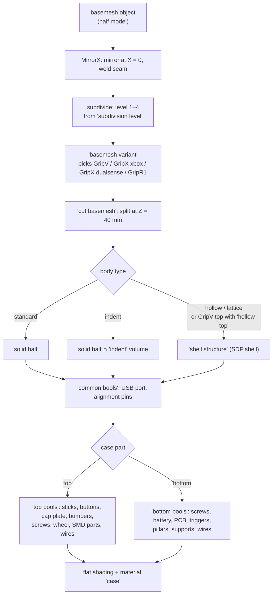

# 5. How the case is made from the basemesh

The case is two objects, `case_top` and `case_bottom`, with the same modifier group `case` and a menu `case part` set to `top` or `bottom` (GripV also has `case_middle_plate`, used by shell bodies). Everything the case looks like follows from: the selected **basemesh**, the global **body type**, and a set of **cutter** objects that are subtracted from it [wiring].

## 5.1 From basemesh to two halves

1. **Basemesh.** `basemesh variant` takes the basemesh collection of the current variant (and, for GripX, of the current style), realizes it, and passes it on [wiring]. The basemesh objects carry their own modifiers: `MirrorX` (mirror across X = 0, delete faces on the plane, weld vertices within 0.1 mm) and a subdivision group whose level is the global `subdivision level` (1 to 4) with edge creases from the `crease_edge` attribute [wiring].
2. **Split.** `cut basemesh` intersects (top) or subtracts (bottom) a 300 × 300 mm box whose lower face is at the hard-coded **cut height Z = 40 mm** [wiring]. On every variant the top starts at exactly Z = 40.000 and the bottom ends there [measured]. The top box stops 0.002 mm under the highest basemesh point, so the very top surface is re-cut [wiring].
3. **Body.** For `standard` the half is used as is. For `indent`, the half is intersected with the `indent` volume. For `hollow` and `lattice`, the whole half is replaced by the `shell structure` result. On GripV with `standard`, the global `hollow top` sends the **top** half through `shell structure` as well [wiring]. See [6. Body types](06-body-types.md).
4. **Common cuts.** `common bools` subtracts the USB opening (`USB BOOL cable holder` when `cable holder` is on, `USB BOOL` when off) and, except for the `hollow` body, the alignment-pin holes (`pin bool`) [wiring].
5. **Top or bottom cuts.** See 5.2.
6. **Finish.** Flat shading and the `case` material [wiring].

## 5.2 What is cut out, and from where

The cutters are objects in the `source` scene. Most are generated by the same modifier groups as the parts, with the part flags turned off (`button` = off, `bool` = on, `hole` = on), so a hole always matches its part's current parameters; the rest are fixed meshes [wiring].

### Top half (`top bools`)

| Cut | Source | Generated or fixed | Global switch |
|---|---|---|---|
| Stick holes | `StickL hole`, `Stick R hole` (modifiers `stick module` / `stick R` with `hole` on) | generated | — |
| Stick cutouts | GripV: `StickL cutout flat`, `Stick R cutout flat`; GripX: `StickL cutout`, `Stick R cutout` (with GN hole-radius adjustment); both: `Stick R cutout appendix` | fixed meshes (GripX ones partly adjusted) | — |
| Button holes | collections `abxy cutouts`, `dpad cutouts` (or `dpad stick cutout` when the dpad stick is on), `home cutout`, `select cutouts` | generated (same groups as the buttons) | `dpad stick` |
| Capacitive opening | `capacitive plate cutout` (plate/knob) or `capacitive plate smd cutout` (disabled) | generated / fixed | capacitive menu |
| Bumper openings | `R1L1 cutouts` (generated `R1L1 bool`), or `R1L1 stock cutouts` (fixed) with stock bumpers; GripR1 uses `R1L1 flex cutouts old` | generated / fixed | `stock bumpers` |
| Screw holes | `screw bools` (modifier `screws`) | generated | `screws` |
| Scroll wheel slot | `Wheel cutout (B)` (modifier `scroll bool`) | generated | — |
| SMD clearances | `LED`, `SMD`, `SMD.001`, `JST-2P (B)` | fixed | — |
| Wire channels | `top wire cutouts` | fixed | `top wire cutouts` |
| R4 wire channel | collection `R4 wire cutouts` | fixed | `R4 wire cutouts` |

`top bools` also contains an unconnected experiment (`cut basemesh and offset curve` → *Trim Curve* → `Curve to Tube`) that does not reach the output [wiring].

### Bottom half (`bottom bools`)

| Cut / addition | Source | Global switch |
|---|---|---|
| Screw holes and nut pockets | `screws` group (generated) | `screws` |
| Battery wire space | `battery wire space` (fixed), only for `standard` and `indent` bodies | — |
| PCB cutout | collection `pcb cutout`: `pcb cutout` (GN `GripX pcb`), `marmota cutout`, `corner relief` | — |
| R2/R4 trigger openings | collection `R2R4 cutouts`: `R2 bool`, `R4 bool` (modifier `trigger` / `R4` with `button` off) | — |
| R4 wire channel | collection `R4 wire cutouts` | `R4 wire cutouts` |
| Bumper openings | collection `R1L1 cutouts` (skipped with stock bumpers) | `stock bumpers` |
| Battery compartment | `coVer base` (from the `cover` preset) | — |
| JST connector pass | `jst2p pass` (fixed) | — |
| PCB supports (kept, not cut) | collection `supports` (`middle supports`, GN `pcb Z tolerance`) is subtracted from the PCB/battery cutter, so those ledges stay in the case | — |
| Pillars (added material) | collections `side pillars`, `middle pillars`, added unless the body is `hollow` | `pillars` |

Measured effect of the switches at the saved settings (volume change of the half, mm³) [measured]:

| Switch change | GripV top | GripV bottom | GripX top | GripX bottom |
|---|---|---|---|---|
| `screws` off | +1,427 | +2,115 | +1,309 | +1,360 |
| `top wire cutouts` on | −1,293 | — | −1,101 | — |
| `R4 wire cutouts` on | −137 | −111 | −132 | −126 |
| `pillars` on | — | +285 | — | +298 |
| `cable holder` off | +0.01 | +319 | +0.005 | +213 |
| `stock bumpers` on | −1,471 | +799 | −927 | +506 |
| capacitive knob → plate (GripV) | −1,337 | — | | |
| capacitive knob → disabled (GripV) | +1,118 | — | | |
| dpad stick on (GripV) | −1,302 | — | | |
| `horizontal buttons` off | −5,557 | — | −4,509 | — |

## 5.3 The middle plate (GripV)

`case_middle_plate` uses the modifier group `middle plate`: a plate shaped from the basemesh outline offset inwards by `inset width`, a PCB pocket, alignment pins placed on the outline at the empties of collection `align cut`, then `plate bools` (screws, USB, pillars, battery and cover cutouts, bumper SDF clearance) [wiring]. Its numbers come from the `middle plate` preset slot (`GripV middle plate parameters`). The object is in the collection `case middle plate`, which the GripV view layer excludes, so as saved it is not evaluated (its mesh reads as empty) and not exported [wiring]. With the collection included it is the same plate for every body type, 156.1 × 71.0 × 10.8 mm between Z 30.8 and 41.6, 8,483 mm³ [measured]. It is meant for shell bodies, where the top and bottom shells clip onto it through the `inner rim` [inferred from the group names and the rim/hook parameters]. Parameter effects are in [6.7](06-body-types.md#67-the-middle-plate-and-the-ledge).

GripX has no middle plate object; its preset slot is filled by `GripX shell middle plate parameters`, whose values still shape the shell's inner rim and PCB pocket [wiring].

## 5.4 Reinforcers and nut lock

`reinforcers` (GripX scene) and `nut lock` (both scenes) use the `screws` group with the `reinforcer` or `nut lock` flag: two screw definitions (FRONT and BACK, picked by `part index` 0 and 1), mirrored to four positions for the case holes and reinforcers; the nut lock is a single, unmirrored piece from the FRONT definition [wiring]. Neither is exported by a preset (see [8. Export](08-export-and-tracking.md)). Details in [Screws](parts/screws.md).

## 5.5 Things to know when editing

- The cut height (40 mm) and the cutter box are constants inside `cut basemesh`, shared by all variants [wiring].
- Cutters in `source` must stay where they are: most have fixed world positions, and the generated ones are placed by their object transforms (for example `abxy cutout right` at X 61, Y −31, Z 40, rotated 90°) [wiring].
- The `GripV` view layer excludes the basemesh collection; it is still evaluated because the case reads it [measured].
