# 6. Body types (standard, indent, hollow, lattice)

The global `body type` decides how the inside of the two case halves is built. `hollow top` adds a fifth combination for GripV: a shell top on a solid bottom. Everything else about the case (split height, cutters) is described in [5. Case](05-case.md).

| Body | What you get | Built by |
|---|---|---|
| `standard` | solid halves | `cut basemesh` only |
| `indent` | solid halves with a shallow textured pattern cut into the outer surface | `indent` (SDF pattern) |
| `hollow` | 1.2 mm shell with a solid top face, ribs, bosses around every opening and a ledge for the middle plate | `shell structure` with `hollow` |
| `lattice` | like `hollow`, but the outer wall is replaced by strips that follow hand-drawn curves | `shell structure` with `lattice` |
| `standard` + `hollow top` (GripV only) | shell top, solid bottom | `shell structure` for the top only |

## 6.1 Measured volumes and times

Case volumes in mm³ at the saved settings with only the body switch changed (`voxel resolution` low) [measured]:

| | GripV top | GripV bottom | GripX xbox top | GripX xbox bottom | GripX dualsense top | GripX dualsense bottom |
|---|---|---|---|---|---|---|
| standard | 130,394 | 180,761 | 125,979 | 153,843 | 108,957 | 147,713 |
| indent (Gyroid) | 129,161 | 173,280 | 123,883 | 147,347 | | |
| hollow | 30,478 | 36,150 | 29,976 | 30,245 | 27,938 | 30,219 |
| lattice | 30,442 | 36,075 | 28,010 | 17,665 | 25,495 | 18,272 |
| standard + hollow top | 34,161 | 180,761 | no effect | | | |

Every hollow, lattice, hollow-top and Gyroid indent half in this table is closed (0 non-manifold edges) [measured]. A whole-scene evaluation took about 0.5 s with `standard`, 3–4 s with `indent`, 7–8 s with `hollow` and 10–12 s with `lattice` when run alone, and 20–40 s when several copies ran in parallel [measured]. The case-export presets use `voxel resolution` = high, which roughly quadruples the shell time (see [3. Global switches](03-global-switches.md#voxel-resolution)).

## 6.2 Cross-sections

Sections through the evaluated halves (red = `case_top`, blue = `case_bottom`, green = `case_middle_plate`). X = 55 mm cuts through the right grip from front to back; Z = 50 is above the split (top half), Z = 20 (GripV) or Z = 25 (GripX) is below it. They were drawn from the evaluated meshes of a copy of the file [measured].

| | X = 55 | Z = 50 | Z = 20 |
|---|---|---|---|
| GripV standard | 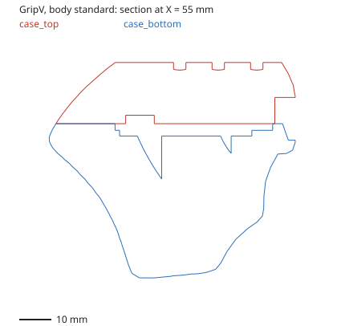 | 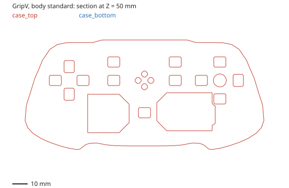 | 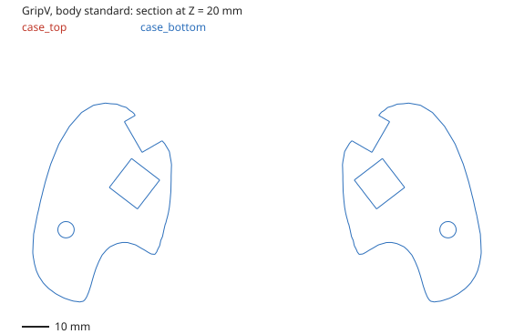 |
| GripV indent | 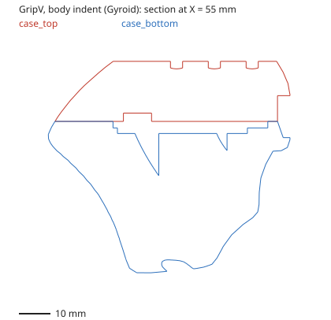 | 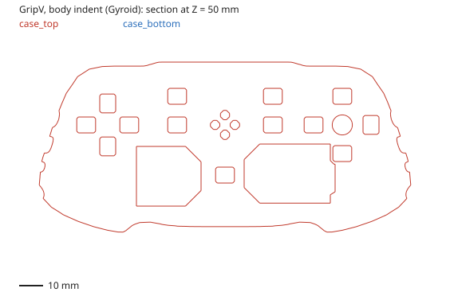 | 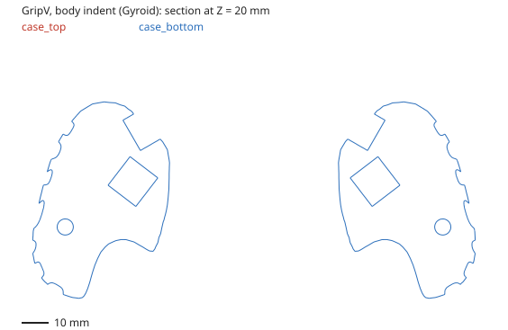 |
| GripV hollow (with middle plate) | 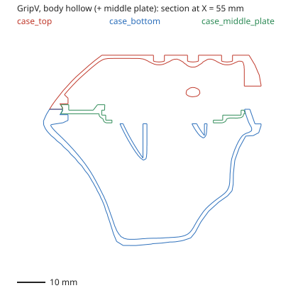 | 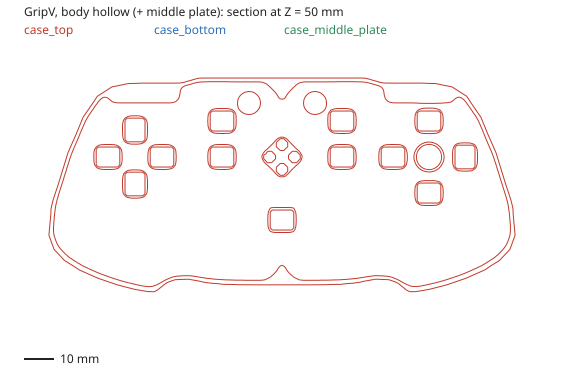 | 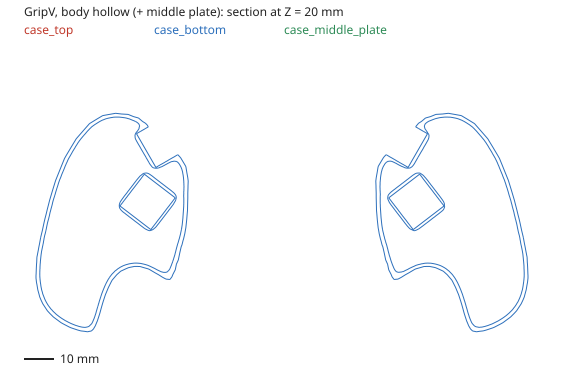 |
| GripV lattice (with middle plate) | 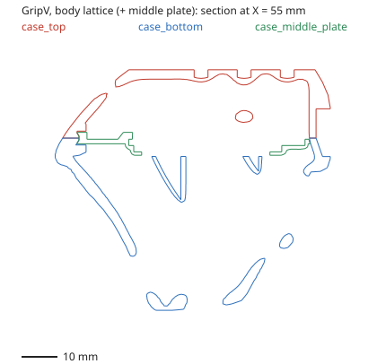 |  | 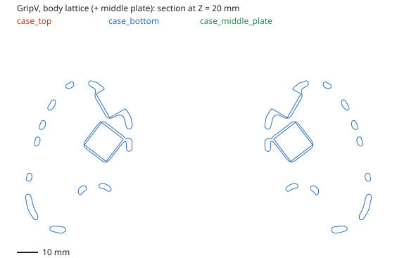 |
| GripV hollow top | 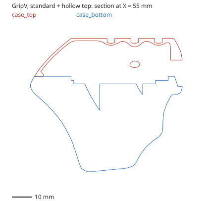 | 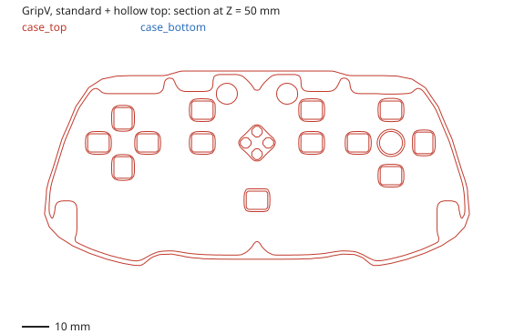 | 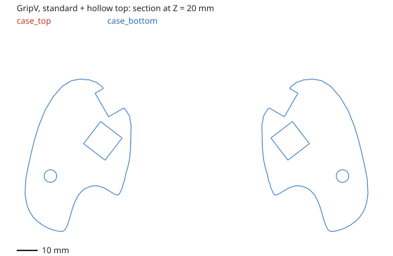 |

| | X = 55 | Z = 50 | Z = 25 |
|---|---|---|---|
| GripX standard | 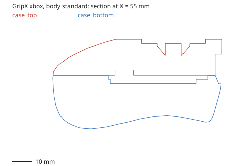 | 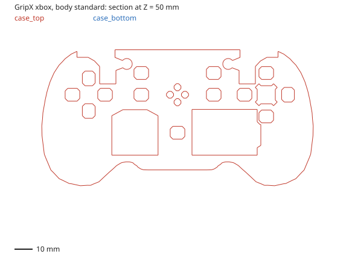 | 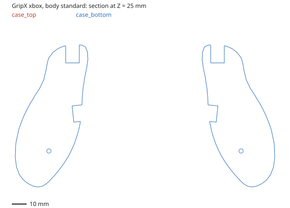 |
| GripX dualsense | 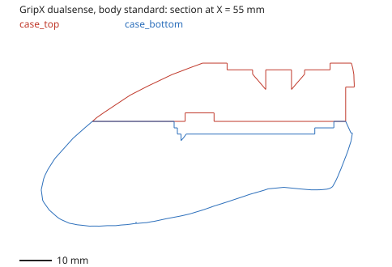 | 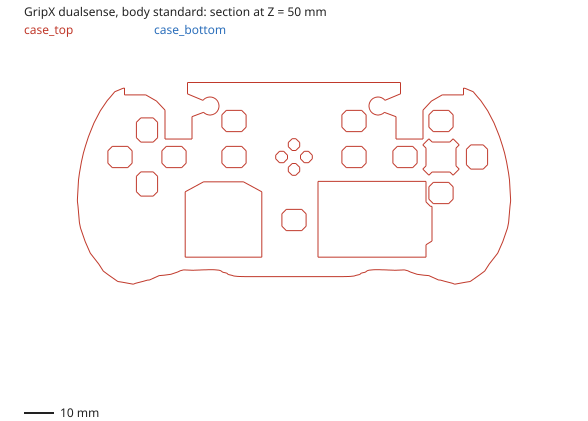 | 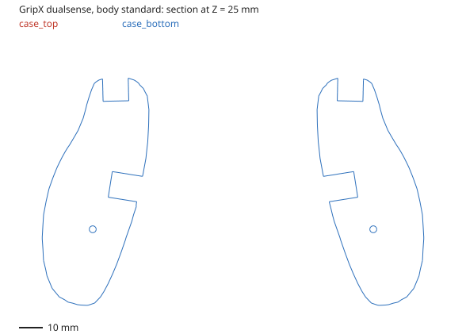 |
| GripX hollow | 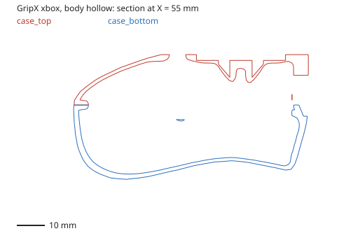 | 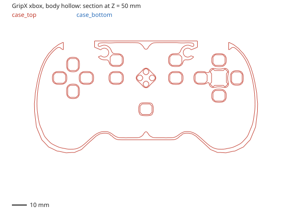 | 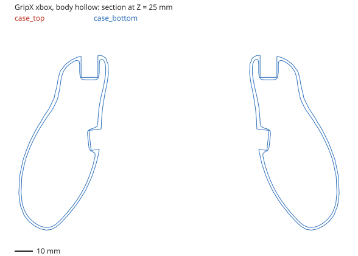 |
| GripX lattice | 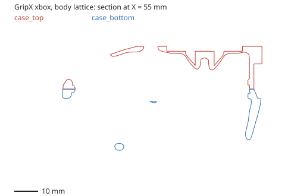 | 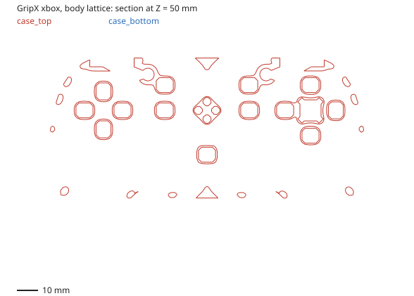 | 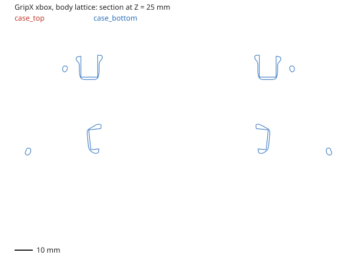 |

[GripV hollow at Z = 40.5](img/GripV_hollow_Z40p5.svg) shows the middle plate and the ledge it sits on, just above the split.

## 6.3 `standard`

The halves are the basemesh cut at Z = 40 with the cutters subtracted; nothing else [wiring].

How the body type gates the other case features (the global outputs are `solid` = standard, `hollow` = hollow, `lattice` = lattice) [wiring]:

| Feature | standard | indent | hollow | lattice |
|---|---|---|---|---|
| screw holes (`screws`) | yes | yes | — | — |
| screw bosses (`screws hollow`) | — | — | yes | yes |
| `battery wire space` cut | yes | yes | — | — |
| battery compartment cutter | extruded | extruded | flat (`no extrude`) | flat |
| `pillars` | yes | yes | — | yes (the condition `lattice AND False` was switched off); measured +715 mm³ GripV, +709 GripX |
| alignment-pin holes (`pins cutouts`) | yes | yes | — | yes (same `AND False`) |
| alignment pins added by the shell | — | — | yes | yes |
| `hollow top` | GripV only | — | — | — |

## 6.4 `indent`: a pattern pressed into the surface

The group `indent` builds a closed volume and the case half is intersected with it [wiring]. Reading the SDF math, that volume is: everything deeper than `fill depth` below the surface, plus everything near the surface where the pattern is "solid", plus the regions that are protected [wiring]. So near the surface, material is removed in pockets up to `fill depth` deep wherever the pattern is "empty", leaving ridges along the pattern [inferred from the wiring; consistent with the measurements: more `thickness` adds material, more `fill depth` removes it]. The Z = 20 section shows the result as a wavy outline on the grips.

Steps [wiring]:

1. **Pattern field** (`pattern field`): the global `fill type` picks one of eight fields with an *Index Switch*: 0 Gyroid, 1 FischerKoch S, 2 FischerKoch CY, 3 Voronoi, 4 Diamond (`schwarz diamond`), 5 Primitive, 6 cubic, 7 manual. Before sampling, the position is multiplied by `scale axis`, folded so the pattern is mirrored about the centre line (|X| − 6) and about the split plane (|Z − 40|), bent by the *droop* warp (`droop height` × `droop multiplier` over a smoothstep of the distance to the basemesh, starting at `droop depth` × `droop multiplier`), moved by `translate`, rotated by `rotate` and scaled by `scale`. The value used is |field| − `thickness`.
2. **Grid**: the field is written into a cube grid around the basemesh (`mesh to grid topology`, cell size from the `lattice` slot, see 6.6).
3. **Protected zones** (`protect parts`): the pattern is kept away from the bumper cutouts, the USB opening (`usb comp`), the screws (`screw comp`, only when screws are on) and the R2/R4 openings. The distances (5, 1, 3, 2, 2 mm) and blend radii (4, 4, 6, 3, 3) are constants inside the group, not preset values.
4. **Fill limit** (`fill limit`): merged (smooth union, radius `limit geometry smooth`) with the SDF of the object `gripx fill limit`. Its *Switch* to `gripx fill limit skeleton` is fixed to off. The same object is used for every variant.
5. **Depth**: smooth union (radius `fill depth smooth`) with the basemesh shrunk by `fill depth`, then smooth intersection (radius `boundary smooth`) with the basemesh grown by `boundary offset`. The basemesh SDF uses the preset's `voxel size` and `band width`.

The `indent` slot holds seven presets per variant (one per fill type) and the global `fill type` picks one [wiring]. Case volumes with each fill type [measured]:

| Fill type | GripV top | GripV bottom | GripX top | GripX bottom |
|---|---|---|---|---|
| (standard, for reference) | 130,394 | 180,761 | 125,979 | 153,843 |
| Gyroid | 129,161 | 173,280 | 123,883 | 147,347 |
| FischerKoch S | 129,157 | 172,319 | 123,599 | 145,724 |
| FischerKoch CY | 129,571 | 172,509 | 123,947 | 146,869 |
| Voronoi | 128,827 | 169,809 | 122,868 | 144,611 |
| Diamond | 129,903 | 175,144 | 124,553 | 148,978 |
| Primitive | 129,442 | 173,889 | 123,869 | 147,903 |
| cubic | 130,044 | 176,440 | 124,529 | 149,278 |
| manual | **empty** | 30,814 (a 122.6 × 47.8 × 64.3 fragment) | **empty** | 19,970 (fragment) |

`manual` is broken: it reads the curves of collection `manual indent`, which is empty, through a muted *Curve to Mesh*, and has no preset in the variant's *Index Switch* (7 entries for 8 menu items) [wiring].

What the indent preset inputs do, measured by changing each once on the Gyroid preset of both variants and on the cubic and Voronoi presets of GripV (change of the GripV Gyroid bottom half in brackets) [measured]:

| Input | Saved (Gyroid) | Effect |
|---|---|---|
| `voxel size` | 1 | resolution of the basemesh SDF (+0.2 → −13 mm³, small) |
| `scale` | 0.3 | pattern frequency: larger = finer pattern (+0.2 → +638 mm³, +13,500 vertices) |
| `thickness` | 0.7 | ridge width (+0.2 → +2,154) |
| `fill depth` | 2.2 | pocket depth (+0.22 → −801) |
| `fill depth smooth` | 2 | rounding of the pocket floor (+0.2 → +280) |
| `boundary smooth`, `boundary offset` | 3, 2 | blend at the outer surface (tens of mm³) |
| `limit geometry smooth` | 3 | blend at the fill-limit object (+54) |
| `rotate`, `translate`, `scale axis` | (π, 0, 0), 0, (1, 1, 1) | orientation, position and per-axis stretch of the pattern |
| `droop height` | 0 | bends the pattern; tiny effect from 0 → 0.2 |
| `droop depth`, `droop multiplier` | 0, 1 | no effect while `droop height` is 0 |
| `band width`, `smooth meshed voxels`, `protect geometry`, `smooth protected geometry`, `shell thickness`, `shell protect geometry`, `shell smooth protected`, `insert rim depth`, `insert rim height`, `insert rim smooth`, `protect flat surface`, `smooth flat surface`, `smooth pattern`, `protect sharp`, `smooth sharp` | | **no effect** with the indent body |

The cubic fill type also reads the `hollow array` slot (`GripV cubic hollow array parameters`, `GripX cubic hollow array parameters`): three plane families, each with `translate`, `rotate` and `interval` (GripV intervals 6, 7, 7 mm; GripX 8, 8, 6). Changing any of them changes the cubic indent (for example GripV interval 6 → 6.6: bottom −1,750 mm³) [measured]. With the hollow and lattice bodies they had no effect [measured], and with the other fill types they are not read [wiring].

## 6.5 `hollow`: the SDF shell

`shell structure` builds each half in these steps [wiring]:

1. **Shell** (`hollow`): the basemesh is converted to a distance field (`part to grid`: voxel size from the hollow preset's `voxel remesh size`, which is linked to the global `voxel resolution`; band from `band remesh width`). The shell is the basemesh grown by 1 mm minus the basemesh shrunk by `shell thickness`. The extra outside millimetre is trimmed again in step 7, so the outer surface stays the basemesh surface and the wall is `shell thickness` thick.
2. **Top face** (`top face`): adds a layer under the flat top of the basemesh (the faces at its highest Z) of thickness `top thickness`. With `top grid` on, that layer is perforated: the pattern object in collection `top face` (`array.002`) is thickened by `grid thickness` and smoothed `smooth grid` times, and solid rings are kept around the stick holes (`stick offset`) and around the button, LED, scroll-wheel and capacitive cutouts (`parts offset`).
3. **Ribs** (`ribs`, only for the top half and only when the global `ribs` is on): the planes in collection `ribs gripv top`, thickened by 0.45 mm, are added.
4. **Battery face** (`battery face`): the lowest face of the basemesh on the centre line, stretched 1.4 × in X and extruded 5 mm, is added as solid material (matters for the bottom half).
5. **Bosses around openings** (`button shafts sdf`): every cutter is grown and added as solid material, so that the normal case cuts later go through solid walls. Top half: the LED, ABXY, D-pad (or D-pad stick), Home and Select cutouts and the capacitive cutout, grown by `protect geometry`; screw bosses grown by `protect geometry` + 0.6 when the screw switch is on; the bumper bodies grown by 2 mm (`lever R1L1 outputs` › `sdf thickness`), or the collection `R1L1 stock cutouts hollow sdf` with stock bumpers. Bottom half: the R2 and R4 openings grown by `protect geometry`, the USB opening grown by 2 mm, screw bosses (`protect geometry` + 0.2) and the lower bumper clearance.
6. **Smoothing**: 3 Laplacian iterations (a constant), then the grid is meshed.
7. **Ledge and trim**: the `inner rim` (the ledge that holds the middle plate, below) is added, then the result is intersected with the basemesh half (cut at Z = 40).
8. **Middle-plate pocket**: the middle plate shape (`plate`), the PCB pocket (`pcb pocket`) and the bumper clearance are subtracted.
9. **Alignment pins** (`align pins`) are added, mirrored.

After that the half goes through the normal common, top and bottom cuts ([5. Case](05-case.md)).

Hollow preset values and measured effects (step = +0.2 or +1; both variants) [measured unless noted]:

| Input | GripV | GripX | Effect of the step |
|---|---|---|---|
| `voxel remesh size` | from `voxel resolution` | from `voxel resolution` | see [voxel resolution](03-global-switches.md#voxel-resolution) |
| `band remesh width` | 3 | 3 | small (tens of mm³) |
| `smooth sdf` | 3 | 3 | **no effect** (the smoothing in step 6 is a constant) |
| `protect geometry` | 0.84 | 0.81 | bosses grow: GripV top +2,044 / bottom +1,038 |
| `shell thickness` | 1.2 | 1.2 | GripV top +2,149 / bottom +3,531; GripX +1,294 / +3,123 |
| `top thickness` | 0.96 (2.4 when `top grid` is on) [wiring] | 2.4 | GripX top +580 |
| `top grid` | off | on | GripX off: top +6,088 (solid instead of perforated) |
| `grid thickness`, `parts offset`, `stick offset`, `smooth grid` | 1.2, 1.6, 3, 3 | same | GripX top +370 / +157 / +66 / +42; no effect on GripV (grid off) |

Global switches with `hollow` [measured]: `ribs` off removes 1,708 (GripV) / 1,232 (GripX) from the top; `screws hollow` on adds screw bosses (GripV +4,226 top / +1,281 bottom; GripX +2,700 / +888); `screws` and `pillars` do nothing; `cable holder` off adds 27 (GripV) / 46 (GripX) mm³ to the bottom.

The group `ribs` passes the collection `ribs gripv top` to both the GripV and the GripX input of its variant switch, so GripX uses the GripV rib planes; a collection `ribs gripx` (`Plane.002`, `Plane.003`) exists but is not used [wiring]. See [Issues](09-issues.md).

### `hollow top` (GripV only)

With the variant GripV and the body `standard`, the global `hollow top` sends the top half through `shell structure` too [wiring]. Steps 8 and 9 are skipped for it (no middle-plate pocket, no pins) because the bottom stays solid [wiring]. Top half: 130,394 → 34,161 mm³ (low voxels), 35,915 mm³ at high voxels; `ribs` off → 32,287 [measured]. It has no effect with any other body or on GripX [measured]. The GripV `Case standard` export preset switches it on, so exported GripV standard tops are shells (see [8. Export](08-export-and-tracking.md)).

## 6.6 `lattice`: strips instead of a wall

`lattice` replaces the shell of step 1 with a different grid; steps 2 to 9 are the same [wiring]. The group `lattice` [wiring]:

1. takes the 24 curves of collection `creases and curves`, mirrored, and makes a field "distance to the curves − 2", i.e. tubes of 2 mm radius around them;
2. writes it into a cube grid around the basemesh whose cell size is the `lattice` slot's `voxel size`, then applies the same protected zones as `indent`;
3. `insert rim`: smooth-unions (radius 7, a constant) a solid band of half-height `insert rim height` around Z = 40, so the halves meet on a closed rim;
4. meshes and smooths that, intersects it with the basemesh shrunk by 1 mm, and keeps only the faces that came from the shrunk basemesh surface, i.e. patches of skin under the tubes;
5. grows those patches by 1.6 mm on each side (voxel 0.96) and smooths them.

So the result is a skin of strips following the curves, plus the top face, ribs, bosses, ledge and pins of the shell [wiring]. Because the patches sit 1 mm under the surface and grow 1.6 mm both ways, and step 7 trims everything outside the basemesh, the strips should be about 2.6 mm thick [inferred]. In the X = 55 section the bottom half is a row of separate strip sections, open between them [measured].

The cube grid of step 2 is built by `mesh to grid topology`, which always reads the `lattice` slot's `voxel size`; the `indent` body uses the same group, so the indent pattern grid also has the lattice cell size (0.6 GripV, 0.5 GripX) while the indent preset's own `voxel size` only sets the basemesh SDF [wiring].

Which preset is the `lattice` slot: GripV uses `GripV  lattice parameters` (two spaces), GripX uses `GripX cubic hollow parameters` [wiring]. Only two of its inputs matter [measured]:

| Input | GripV | GripX | Effect |
|---|---|---|---|
| `voxel size` | 0.6 | 0.5 | resolution of the tube field (GripV +0.2: bottom −858, top −363) |
| `insert rim height` | 2.4 | 3.5 | height of the closed rim at the split (GripX +0.35: +311 top and bottom) |
| everything else in the slot (`holllow lattice parameters`, `scale`, `thickness`, `fill depth`, smoothing, droop, `top face parameters` of the lattice preset, …) | | | **no effect** |

The tube radius (2), skin thickness (1.6), shrink (1) and smoothing (5 iterations) are constants in the group [wiring]. The top face, ribs and bosses come from the `hollow` slot, so the hollow preset's `protect geometry` and the global `voxel resolution` still apply [wiring]. Global switches with `lattice` [measured]: `ribs` off GripV top −2,114, GripX −1,422; `screws hollow` on GripV +4,794 / +1,658, GripX +3,530 / +1,842; `voxel resolution` high GripV 33,593 / 38,864.

**The lattice is only drawn for GripV.** All 24 curves in `creases and curves` carry a *Shrinkwrap* modifier (project, above surface) whose target is `basemesh GripV` [wiring]. With GripX the curves still follow the GripV surface, which is why the GripX lattice bottom is half the volume of its hollow bottom (17,665 vs 30,245 mm³) and narrower than the GripX standard bottom (171.7 × 91.7 mm instead of 175.5 × 99.2) [measured]. See [Issues](09-issues.md).

## 6.7 The middle plate and the ledge

The middle plate (`case_middle_plate`, GripV only) is a separate printed part that the hollow and lattice halves clip onto [inferred from the group and parameter names]. It sits in the collection `case middle plate`, which the GripV view layer **excludes**, so in the file as saved it is not evaluated and not exported [wiring]. When the collection is included it evaluates to the same plate for every body type: 156.1 × 71.0 × 10.8 mm, Z 30.8 to 41.6, 8,483 mm³, 23,667 vertices, closed [measured].

The `middle plate` slot (GripV `GripV middle plate parameters`, GripX `GripX shell middle plate parameters`) shapes both the plate and the ledge (`inner rim`) and pocket in the shell halves [wiring]. Effect of each input (GripV, hollow body, plate included) [measured]:

| Input | GripV | GripX | Plate | Shell halves |
|---|---|---|---|---|
| `insert height` | 1.92 | 1.76 | +0.2 → plate 0.2 taller, +718 mm³ | small (−18 top / +36 bottom) |
| `inset width` | 3 | 3 | +0.3 → −143, plate 0.66 × 0.72 smaller | ledge moves inward: +415 top / +562 bottom |
| `plate inset width` | 2.6 | 2.6 | +164 | −14 top |
| `hook inset` | 0.6 | 0.4 | +76, 0.37 wider | −97 / −152 |
| `hook height` | 0.64 | 0.5 | −65 | +97 / +147 |
| `slant height` | 0.92 | 0.92 | −26 | +77 / +127 |
| `rim slant height` | 7 | 3 | — | +23 / +155 |
| `rim slant outset` | 6 | 16 | — | −21 / −92 |
| `pcb pocket thickness` | 1.28 | 1.28 | +476, 0.2 taller | bottom −86 |
| `xy tolerance` | 0 | −0.1 | −113, 0.4 smaller in X and Y | — |
| `Z tolerance` | 0.32 | 0.16 | −716, 0.2 thinner | — |
| `fit Z tolerance` | 0.1 | −0.2 | +65 | — |
| `inner Z tolerance` | 0.32 | 0.16 | −410 | — |
| `inner xy tolerance` | 0.4 | 0.4 | −127 | — |
| `pcb pocket tolerance` | 0.32 | 0.32 | −501, underside moves up 0.2 | — |
| `hook to top` | 0.32 | 0.64 | no effect | no effect |

The same inputs changed the GripX shell halves in the same way (GripX has no plate object) [measured]. The ledge is built from the basemesh outline at Z = 40 offset inward by `inset width` (`offset basemesh and slice`), extruded and slanted by the hook and slant values, plus support blocks from a per-variant collection (`GripV middle plate supports`, `Xbox syle middle plate supports`, `dualsense style middle plate supports`, `GripR1 middle plate supports`) [wiring].

## 6.8 Things to know when editing

- The split height Z = 40 is repeated as a constant in `cut basemesh`, `plate`, `offset basemesh and slice`, `insert rim` and `pattern field` [wiring]. Changing it means changing all five.
- Several preset inputs are placeholders: in the hollow slot `smooth sdf`; in the indent and lattice presets the shell, protect, flat-surface, sharp and pattern-smoothing inputs. Their values do nothing today [measured]. The protected-zone distances and smoothing that do act are constants inside `protect parts` [wiring].
- Shell bodies are slow; set `voxel resolution` to low while editing and let the export presets switch it to high.
