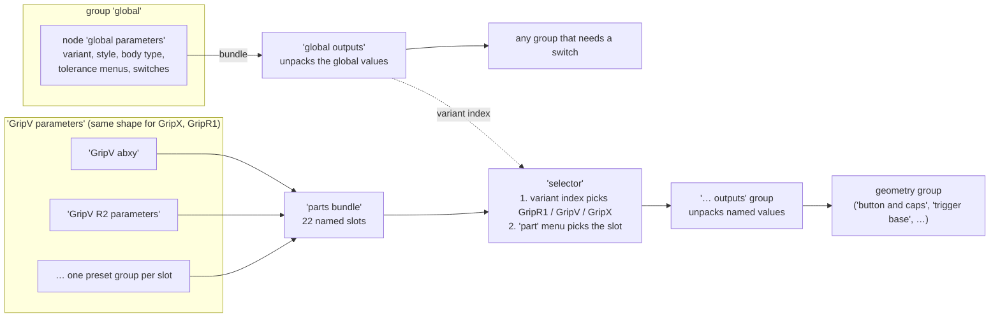

# 2. Parameter system

Almost no dimension is typed into a geometry group. Numbers live in **preset groups** and reach the geometry inside **bundles** (Blender 5 bundle sockets). This page explains that plumbing and why it is built this way.

## The picture



There are two separate channels:

1. **Global settings**: one set for the whole file.
2. **Part presets**: one set per variant.

**Why it is built this way:** the geometry groups do not know which controller they are building. They ask `selector` for "the abxy numbers" and get the GripV or GripX ones depending on the global variant. A new variant needs presets and a basemesh, not new geometry. And because a preset is a bundle, adding a value to a part does not mean adding a socket to every group between the panel and the geometry.

## Global settings

The group `global` contains one node, an instance of `global parameters`. Its input values are the global settings. `global parameters` converts them, menus to indices and booleans, and packs them into a bundle. `global outputs` unpacks that bundle. It is dropped into every group that needs a switch (dozens of places).

Some derived values are worth knowing:

- `variant index`: GripR1 = 0, GripV = 1, GripX = 2. `selector`, `basemesh variant` and `part variant switching` switch on it.
- `gripD`: true when the variant is GripX and the style is dualsense. Inside `global parameters`, `style` is forced to dualsense for other variants, but nothing outside GripX reads it.
- `solid`, `hollow`, `lattice`: from `body type`; they gate features in the case (see [Case pipeline](03-case-pipeline.md#how-the-body-type-gates-other-features)).
- `fill type` is forced to `cubic` unless the body is `indent`.

The export add-on overrides global settings by addressing `global` › `global parameters` › input name.

## Part presets

```
GripV parameters                       (variant parameter group)
├─ GripV abxy                          (preset group: no inputs, one bundle output)
│  ├─ button parameters                (constructor: the typed values are the design)
│  ├─ caps parameters
│  ├─ curve parameters
│  ├─ capacitive plate parameters
│  ├─ marks parameters
│  └─ tolerance set ×2                 (tight / default / loose, picked by a global menu)
├─ GripV R2 parameters
│  └─ …
└─ parts bundle                        (packs all slots into one bundle)
```

- A **variant parameter group** (`GripV parameters`, `GripX parameters`, `GripR1 parameters`) holds one preset group per slot and packs them with `parts bundle`.
- A **preset group** (`GripV abxy`, `GripX lever R1L1`, …) holds instances of generic constructors and joins their bundles.
- A **constructor** (`button parameters`, `trigger parameters`, …) is a small group that packs its inputs into a bundle. The values typed on its instance in a preset are the design values. Its own interface defaults are irrelevant except for new nodes.

The 22 slots of `parts bundle` are `abxy`, `dpad`, `select`, `home`, `R2`, `R4`, `R1L1`, `R1`, `L1`, `screw`, `stick R`, `stick L`, `scrollwheel`, `pcb`, `cover`, `pin`, `dpad stick`, `indent`, `middle plate`, `hollow array`, `hollow` and `lattice`. `R1` and `L1` are only filled by GripR1. The `indent` slot holds seven presets per variant behind an *Index Switch* driven by `fill type`. The eighth menu entry, `manual`, has no preset.

## How a part reads its values

A generator places a `selector` node with its `part` menu set (for example `abxy`), followed by one or more `… outputs` groups:

1. `selector` evaluates the three variant groups, picks one bundle with an *Index Switch* on `variant index`, separates the 22 slots, and picks one with a *Menu Switch* on `part`.
2. `button outputs`, `caps outputs`, `trigger outputs`, … each contain a *Separate Bundle* whose outputs go to the group outputs, so the generator gets plain named sockets.
3. The geometry group uses them as ordinary inputs.

`selector` also has a `part index` (0 or 1) that is passed into every variant group. Only the screw presets use it, to return the FRONT (0) or BACK (1) screw definition. The same generator thus builds two different screws.

## Styles and alternatives inside a preset

A preset group can hold several constructor nodes for the same thing and choose between them:

| Pattern | Where | How it switches |
|---|---|---|
| per style | GripX triggers, bumpers, back screws | a *Switch* on `gripD` between frame "GripX" (xbox) and frame "GripD" (dualsense) |
| named presets | GripX `stick L parameters`, `stick R parameters` | a *Menu Switch* between complete stick definitions, driven by a separate *Menu* node (`stick menu`). The export preset overrides the *Menu Switch* directly. |
| per fill type | the `indent` slot | an *Index Switch* on `fill type` |
| leftovers | GripV trigger frame "SNES", GripX cover frame "battery", a sixth GripX StickL set, the GripX bumper `tolerance set` | not connected; kept as reference |

## Tolerance sets

`tolerance set` takes `tight`, `default` and `loose` values and an index, and returns one value. Preset groups wire the index to a global tolerance menu and feed the result into a constructor input. So each part decides what "tight" means for itself, and one global menu switches every part. It also lets the exporter sweep a menu and get three versions of every part.

| Global menu | Bundle key | Feeds |
|---|---|---|
| `tolerance` | `button tol` | button shafts; trigger X and radius fit |
| `press tolerance` | `button press tol` | trigger press fit; GripV bumper press fit |
| `cap tolerance` | `cap tol` | cap fit on the shaft |

Inside `global parameters` the nodes that convert the press and cap menus are named the wrong way round (the node `cap tolerance` reads the press menu). The bundle keys they write are correct.

## The controls panels

`GripV controls`, `GripX contols` and `GripR1 controls` are groups with no inputs or outputs. Each holds one instance of `global` and of every preset group of its variant, arranged in frames (BUTTONS, STICKS, R2R4, R1L1 LEVER, SCREWS, PINS, PCB AND BATTERY, SCROLLWHEEL, DPAD STICK, pattern/FILL, shell/SHELL). A group node shows the shared group data, so editing inside the panel edits the real preset. The group `controls` holds all three panels. It sits as a modifier on the hidden object `case_front.002` (collection `references` › `other`), probably so the panel has a modifier user and is easy to open. `blender_tracking` tracks the GripV and GripX panels.

## Bundle keys

Keys are matched by name. A constructor usually packs an input under its own name, but some rename on the way in or out:

- `button parameters` packs `case middle bevel` under `middle bevel` and the reverse. Downstream they are swapped back, so the labels are right.
- `stick top parameters` packs `top curvature` as `texture type`, and `texture type` as `flat texture type`. `stick outputs` renames them back.
- `pcb cutout parameters` packs `PCB support edge` as `PCB offset support`.
- `cover outputs` passes `lip hook height` on as `hook height`.
- Five `… outputs` groups rename keys (`cover`, `lever R1L1`, `shell`, `stick`, `trigger`).

A key the bundle does not carry comes out of the *Separate Bundle* as the socket default (zero, off or empty), and nothing warns about it. Two keys are read but never written: `PCB z tolerance` (on the `middle supports` cutter, so the board supports are never offset) and `extra thickness` (clip objects in `source` only).

## Values that are not parameters

| Where | Value | What it does |
|---|---|---|
| `cut basemesh`, `plate`, `offset basemesh and slice`, `insert rim`, `pattern field` | **40** | the split height between case top and bottom (also a constant 40 in `screw`) |
| `cut basemesh` | 0.001, −10 | the top cutter stops just under the basemesh top; the bottom cutter extends above it |
| `button outputs` | 8 / 1 | top bevel segments of the shaft (1 with `horizontal buttons`) |
| `button and caps` | +0.23 | added to the cap hook inset for the cutter |
| `lever R1L1 outputs` | `sdf thickness` 2 | clearance around the bumpers in shell bodies |
| `dpad stick outputs` | 1 | the same for the D-pad stick |
| `stick outputs` | 0.3 | icosahedron pattern offset |
| `protect parts` | 5, 1, 3, 2, 2 mm (blend radii 4, 4, 6, 3, 3) | how far patterns and lattices keep away from the bumper, USB, screw, R2 and R4 openings |
| `shell structure` | 3 iterations | smoothing of the shell (the preset's `smooth sdf` is not used) |
| `lattice` | tube radius 2, skin 1.6, shrink 1, 5 smoothing steps, rim blend 7 | the lattice geometry |
| `nail cut` | radius 8, depth 13.9, 34 mm along Y | the finger notch of the battery cover |
| `MirrorX` | merge 0.1, seam tolerance 0.01 | mirroring of half models |

## Legacy plumbing

`part and variant`, `main switch`, `bundle variant switching base` and `GripR1  parameters` (two spaces) are an older version of the same selection, with a different slot list. They are reached only through `R4R2 parameters` → `topoff` → `trigger cap`, which is not connected to anything that is output. That makes the chain dead code. A further ten groups are not reachable from any modifier at all ([Known issues](07-known-issues.md)).
