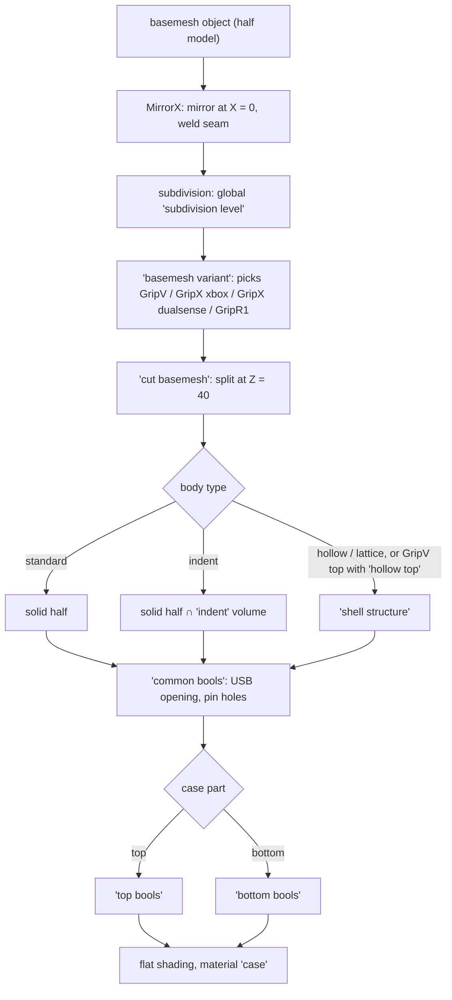

# 3. Case pipeline

`case_top` and `case_bottom` both use the group `case`, with `case part` set to top or bottom. The case is the basemesh, split in two, built according to the body type, minus every part's cutter.

## From basemesh to two halves

1. **Basemesh.** `basemesh variant` takes the basemesh collection for the current variant and style and realizes it. The basemesh objects carry their own modifiers: `MirrorX` (mirror across X = 0, delete faces on the plane, weld within 0.1 mm) and a subdivision group that reads the global `subdivision level` and the `crease_edge` attribute. *Why:* the shape is modelled once as a half, and smoothness becomes an export setting rather than a modelling one.
2. **Split.** `cut basemesh` intersects (top) or subtracts (bottom) a large box whose lower face is at **Z = 40**. That height is a constant here and in four other groups (see [Parameter system](02-parameter-system.md#values-that-are-not-parameters)).
3. **Body.** `standard` uses the half as it is. `indent` intersects it with the pattern volume. `hollow` and `lattice` replace it with the result of `shell structure`. On GripV with `standard`, the global `hollow top` sends only the top through `shell structure`.
4. **Common cuts.** `common bools` subtracts the USB opening (two fixed meshes, chosen by `cable holder`) and the alignment pin holes (not for `hollow`).
5. **Top or bottom cuts.** See the next section.

## What is cut from each half

Generated cutters use the part's own generator with the part flag off, so they follow the part's preset. Fixed cutters are meshes in `source` and follow nothing.

### Top half (`top bools`)

| Cut | Cutter | Kind | Switched by |
|---|---|---|---|
| stick holes | `StickL hole`, `Stick R hole` | generated | — |
| stick cutouts | GripV `StickL cutout flat`, `Stick R cutout flat`; GripX `StickL cutout`, `Stick R cutout` (partly adjusted by `case cutout thickness`); `Stick R cutout appendix` | fixed | variant |
| button holes | collections `abxy cutouts`, `dpad cutouts` (or `dpad stick cutout`), `home cutout`, `select cutouts` | generated | D-pad stick switch |
| capacitive opening | `capacitive plate cutout`, or `capacitive plate smd cutout` when disabled | generated / fixed | capacitive mode |
| bumper openings | `R1L1 cutouts` (`R1L1 bool`), or `R1L1 stock cutouts` | generated / fixed | `stock bumpers` |
| screw holes and nut pockets | `screw bools` | generated | `screws` |
| scroll wheel slot | `Wheel cutout (B)` | generated | — |
| board component clearances | `LED`, `SMD`, `SMD.001`, `JST-2P (B)` | fixed | — |
| wire channels | `top wire cutouts`, `R4 wire cutouts` | fixed | `top wire cutouts`, `R4 wire cutouts` |

`top bools` also holds an unconnected experiment (`cut basemesh and offset curve` → *Trim Curve* → `Curve to Tube`).

### Bottom half (`bottom bools`)

| Cut or addition | Source | Switched by |
|---|---|---|
| screw holes, head recesses | `screws` group | `screws` |
| battery compartment | `coVer base` (from the `cover` preset) | — |
| battery wire space | `battery wire space` (fixed) | solid bodies only |
| PCB slot | collection `pcb cutout`: `pcb cutout` (generated by `GripX pcb`, used by both variants), `marmota cutout`, `corner relief` | — |
| board supports (kept, not cut) | collection `supports` (`middle supports`) is subtracted from the PCB cutter, so the support blocks stay | — |
| trigger openings | collection `R2R4 cutouts` (`R2 bool`, `R4 bool`) | — |
| bumper openings | `R1L1 cutouts` | `stock bumpers` |
| R4 wire channel | `R4 wire cutouts` | `R4 wire cutouts` |
| JST connector pass | `jst2p pass` (fixed) | — |
| pillars (added) | collections `side pillars`, `middle pillars` | `pillars`, not with `hollow` |

## How the body type gates other features

| Feature | standard | indent | hollow | lattice |
|---|---|---|---|---|
| screw holes (`screws`) | yes | yes | — | — |
| screw bosses (`screws hollow`) | — | — | yes | yes |
| `battery wire space` | yes | yes | — | — |
| battery compartment | extruded cutter | extruded | flat (`no extrude`) | flat |
| `pillars` | yes | yes | — | yes (*) |
| pin holes (`pins cutouts`) | yes | yes | — | yes (*) |
| alignment pins added by the shell | — | — | yes | yes |
| `hollow top` | GripV only | — | — | — |

(*) The exclusion is written as `lattice AND False`, so lattice still gets pillars and pin holes. This is probably a temporary switch-off.

## `indent`: a pattern pressed into the surface

The group `indent` builds a closed volume, and the half is intersected with it. The volume is everything deeper than `fill depth` below the surface, plus the near-surface regions where the pattern is solid, plus protected zones. Pockets up to `fill depth` deep are therefore removed wherever the pattern is empty.

1. **Pattern field** (`pattern field`): `fill type` picks one of eight fields with an *Index Switch* (Gyroid, FischerKoch S, FischerKoch CY, Voronoi, Diamond, Primitive, cubic, manual). Before sampling, the position is stretched by `scale axis` and folded about the centre line (|X| − 6) and the split plane (|Z − 40|). That makes the pattern symmetric left/right and continuous across the split. It is then bent by the droop warp, moved, rotated and scaled. The value used is |field| − `thickness`.
2. **Grid** (`mesh to grid topology`): the field is written into a voxel grid around the basemesh. The cell size comes from the **lattice** slot's `voxel size`, because the same group serves the lattice.
3. **Protected zones** (`protect parts`): the pattern is kept away from the bumper, USB, screw, R2 and R4 openings, so they always cut through plain material. The distances are constants.
4. **Fill limit** (`fill limit`): smooth union with the SDF of `gripx fill limit`, which marks where the pattern stops. The same object is used for every variant.
5. **Depth**: smooth union with the basemesh shrunk by `fill depth`, then smooth intersection with the basemesh grown by `boundary offset`.

`manual` reads the curves of the empty collection `manual indent` through a muted *Curve to Mesh* and has no preset. It is unfinished.

## `hollow`: the SDF shell (`shell structure`)

Each half is built as a signed distance field and meshed once. That is why shells are smooth and closed, and why they are slow.

| Step | Group | What it does, and why |
|---|---|---|
| 1. shell | `hollow` | the basemesh as a distance field. The shell is the basemesh grown by 1 mm minus the basemesh shrunk by `shell thickness`. The extra outside millimetre is trimmed in step 7, so the outer surface stays exactly the basemesh. Voxel size comes from `voxel remesh size`, which is linked to the global `voxel resolution`. |
| 2. top face | `top face` | adds a solid layer `top thickness` under the flat top of the controller, where the buttons sit. With `top grid` it is perforated by the pattern object `array.002`, with solid rings left around the stick holes and the button openings. |
| 3. ribs | `ribs` | top half only, with global `ribs`: adds the rib planes of `ribs gripv top` (0.45 mm thick) to stiffen the large flat top |
| 4. battery face | `battery face` | adds solid material under the battery compartment (the lowest basemesh face on the centre line, widened and extruded), probably so the compartment is cut into solid material |
| 5. bosses | `button shafts sdf` | grows every cutter and adds it as solid material, so the later cuts go through solid walls: button, LED and capacitive openings by `protect geometry`, screws by `protect geometry` + 0.6 (top) or + 0.2 (bottom) when `screws hollow` is on, bumpers by 2 mm, trigger openings by `protect geometry`, USB by 2 mm |
| 6. smoothing | — | 3 Laplacian iterations (a constant), then meshing |
| 7. ledge and trim | `inner rim` | adds the ledge the middle plate rests on, then intersects with the basemesh half (cut at Z = 40) |
| 8. plate pocket | `plate`, `pcb pocket` | subtracts the middle plate, the board pocket and the bumper clearance |
| 9. pins | `align pins` | adds alignment pins at the `align cut` empties, mirrored |

After this, the half goes through the normal common, top and bottom cuts. `hollow top` runs steps 1 to 7 for the GripV top only, because a solid bottom has no plate.

The group `ribs` passes `ribs gripv top` to both its GripV and GripX inputs, so GripX uses the GripV ribs. `ribs gripx` exists but is not connected.

## `lattice`: strips instead of a wall

`lattice` replaces step 1 of the shell. Steps 2 to 9 are the same.

1. The 24 curves of `creases and curves`, mirrored, become a field of 2 mm tubes.
2. The field is written into the voxel grid of the lattice slot's `voxel size`, with the same protected zones as `indent`.
3. `insert rim` blends in a closed band of `insert rim height` around Z = 40, so the halves meet on a continuous rim.
4. The result is meshed, smoothed and intersected with the basemesh shrunk by 1 mm. Only the faces that came from that shrunk surface are kept, which gives patches of skin under the tubes.
5. The patches are thickened by 1.6 mm each way and smoothed.

So the case wall becomes strips that follow the curves, with the top face, ribs, bosses, ledge and pins of the shell. The curves carry *Shrinkwrap* modifiers that target `basemesh GripV`, so they only fit GripV.

## The middle plate and the ledge

`case_middle_plate` (group `middle plate`) is a plate shaped from the basemesh outline at Z = 40 inset by `inset width`. It has a board pocket and alignment pins at the `align cut` markers. `plate bools` then cuts the screws, USB, pillars, battery compartment and bumper clearance from it. The shells' `inner rim` builds the matching ledge from the same outline (`offset basemesh and slice`), extruded and slanted by the hook and slant values. Support blocks come from a collection per variant and style. Plate and ledge read the same `middle plate` slot, so they always fit each other.

GripX has no plate object. Its slot (`GripX shell middle plate parameters`) still shapes the ledge and pocket inside the GripX shells.
